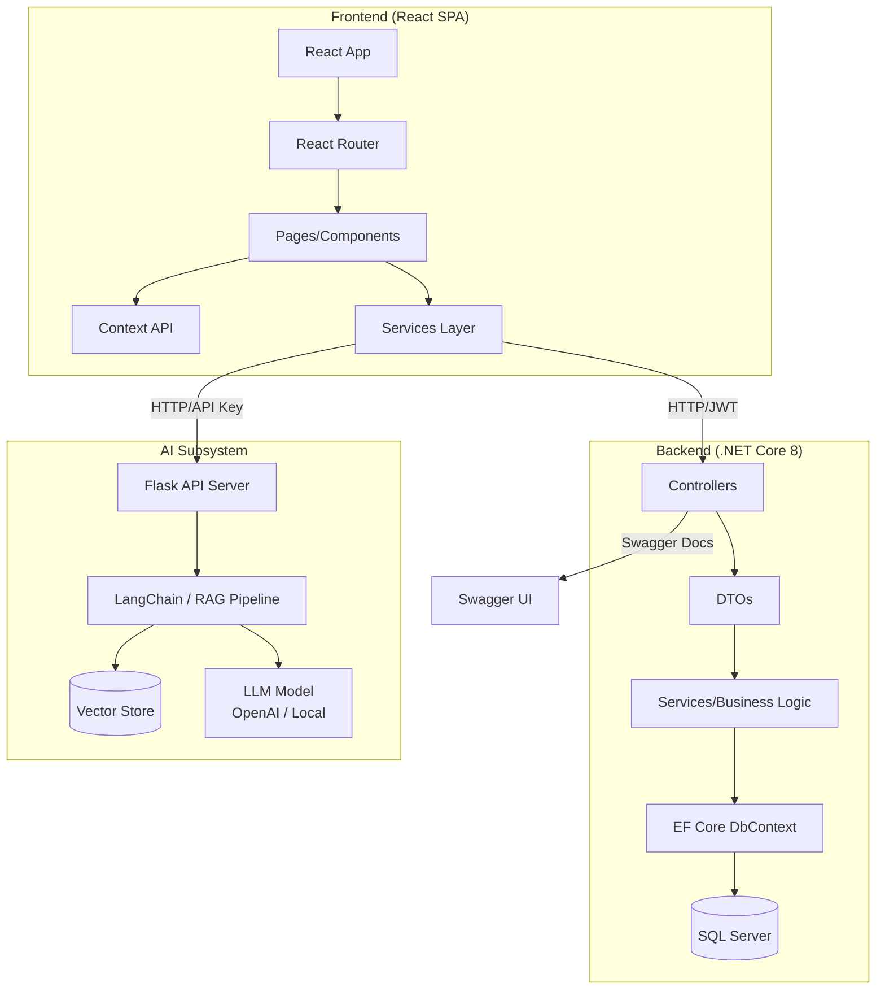
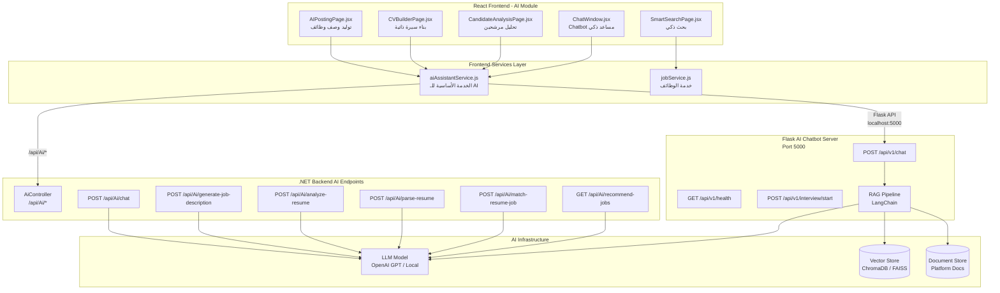
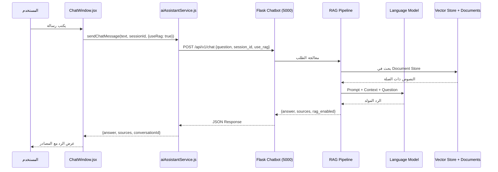
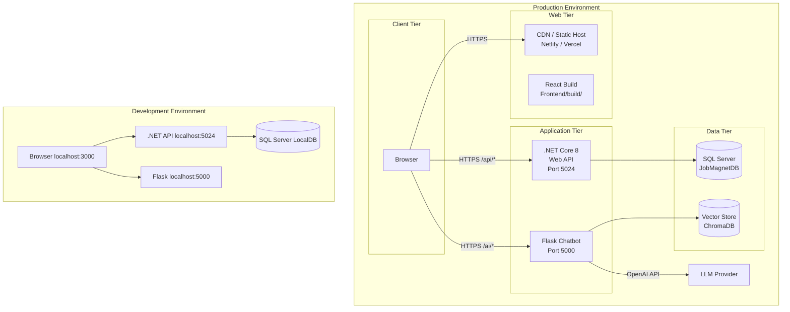
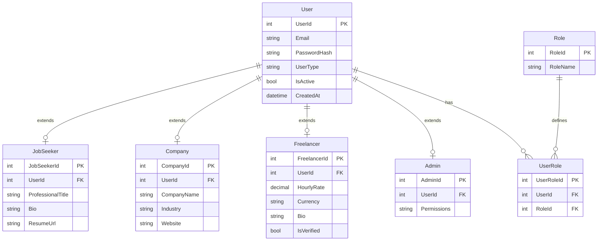
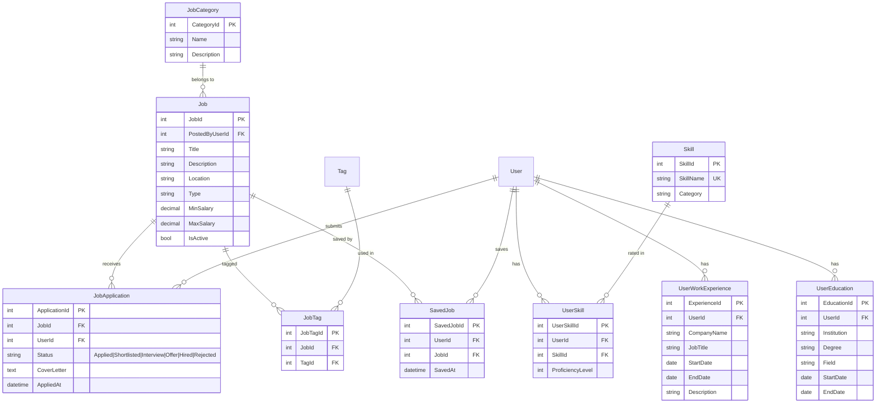
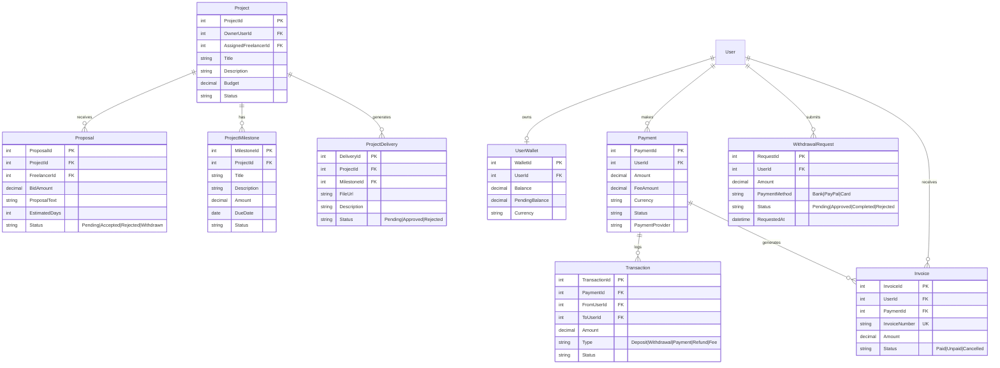
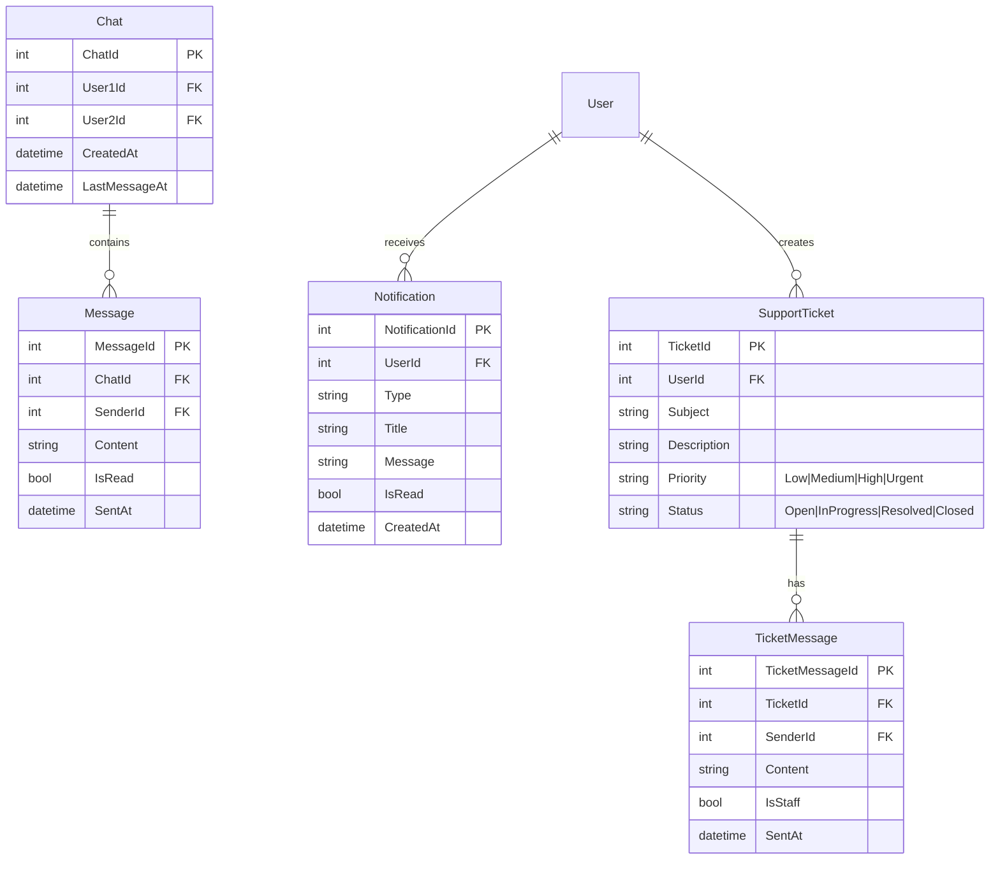

# توثيق مشروع MAESTA - شامل كامل

> **آخر تحديث:** 2026-06-30  
> **نوع المشروع:** منصة سوق عمل (Job Marketplace) - مشروع تخرج  
> **الفريق:** Mohamed Amin, Sherif Talaat, Shahd Mohay  
> **النسخة:** 1.0.0

---

## فهرس المحتويات

1. [نظرة عامة على المشروع](#1-نظرة-عامة-على-المشروع)
2. [عمارة النظام الشاملة (System Architecture)](#2-عمارة-النظام-الشاملة)
3. [عمارة الـ Backend بالتفصيل](#3-عمارة-الـ-backend-بالتفصيل)
4. [عمارة الـ AI والذكاء الاصطناعي بالتفصيل](#4-عمارة-الـ-ai-والذكاء-الاصطناعي-بالتفصيل)
5. [عمارة الـ Database](#5-عمارة-الـ-database)
6. [عمارة الـ Frontend (موجز)](#6-عمارة-الـ-frontend-موجز)
7. [مرجع API (قائمة الـ Endpoints)](#7-مرجع-api)
8. [عمارة النشر (Deployment)](#8-عمارة-النشر)
9. [الحالة الحالية وخارطة الطريق](#9-الحالة-الحالية-وخارطة-الطريق)
10. [مخططات ERD الكاملة](#10-مخططات-erd-الكاملة)

---

## 1. نظرة عامة على المشروع

**MAESTA** هي منصة متكاملة لإدارة سوق العمل، تهدف إلى ربط **الباحثين عن عمل** و**الشركات** و**المستقلين (Freelancers)** والـ **Clients** في بيئة واحدة. توفر المنصة أدوات متقدمة مثل **التوظيف الذكي بالذكاء الاصطناعي**، **نظام الضمان المالي (Escrow)**، **الدردشة الفورية**، **لوحات تحكم مخصصة لكل دور**، وسوق **Gigs** للمشاريع الصغيرة.

### القيمة المضافة الأساسية

| الميزة | الوصف |
|--------|-------|
| **المطابقة الذكية للوظائف** | نظام مطابقة قائم على المهارات مع نسبة توافق مئوية |
| **سوق المشاريع (Gigs)** | نشر والعطاء على مشاريع freelance مع مساحة عمل مشتركة |
| **حزمة أدوات AI** | نشر مدعوم بالذكاء الاصطناعي، بناء سيرة ذاتية، تحليل مرشحين، بحث ذكي |
| **نظام Escrow للدفع** | تدفق دفع آمن مع إدارة السحب |
| **لوحات تحكم حسب الدور** | تجربة مستخدم مختلفة تمامًا لكل نوع مستخدم |
| **دردشة فورية** | نظام محادثة مع حالة مستمرة |
| **مجتمع متكامل** | منشورات، إعجابات، تعليقات، تقارير |

### الأدوار المدعومة

```
JobSeeker (باحث عن عمل) → يبحث عن وظائف ويتقدم لها
Company (شركة)          → ينشر وظائف ويقيم المتقدمين
Freelancer (مستقل)      → يقدم عروض على مشاريع Gigs
Client (عميل)           → ينشر مشاريع Gigs ويوظف مستقلين
Admin (مسؤول)           → يدير المنصة بالكامل والمستخدمين والمحتوى
```

### التقنيات المستخدمة

| الطبقة | التقنية | الغرض |
|--------|---------|-------|
| **Frontend Framework** | React 18 + Tailwind CSS + CSS Modules | واجهة المستخدم |
| **State Management** | Context API (7 Contexts) | إدارة الحالة |
| **Routing** | React Router v6 | التنقل بين الصفحات |
| **Backend** | ASP.NET Core 8 Web API | الخادم - واجهة برمجة التطبيقات |
| **ORM** | Entity Framework Core 8 | التعامل مع قاعدة البيانات |
| **Database** | SQL Server | تخزين البيانات |
| **AI Chatbot** | Flask Python API + RAG | Chatbot ذكي |
| **Authentication** | JWT Bearer Tokens | المصادقة |
| **API Documentation** | Swagger / OpenAPI | توثيق API |
| **Icons** | Lucide React | أيقونات موحدة |
| **Code Splitting** | React.lazy + Suspense | تحسين الأداء |

---

## 2. عمارة النظام الشاملة

```
┌─────────────────────────────────────────────────────────────────────────────┐
│                            MAESTA SYSTEM ARCHITECTURE                        │
└─────────────────────────────────────────────────────────────────────────────┘

                                    ┌─────────────────┐
                                    │   Browser (SPA) │
                                    │   React 18      │
                                    └────────┬────────┘
                                             │
                                    ┌────────▼────────┐
                                    │   Axios HTTP     │
                                    │   JWT in Header  │
                                    └────────┬────────┘
                                             │
                    ┌────────────────────────┼────────────────────────┐
                    │                        │                        │
            ┌───────▼───────┐       ┌───────▼───────┐       ┌───────▼───────┐
            │  .NET Backend  │       │  Flask AI     │       │  External     │
            │  ASP.NET Core 8 │       │  Chatbot API   │       │  OAuth        │
            │  Port 5024     │       │  Port 5000    │       │  (Google/     │
            │  /api/*        │       │  /api/v1/*    │       │   LinkedIn)   │
            └───────┬───────┘       └───────┬───────┘       └───────────────┘
                    │                       │
            ┌───────▼───────┐       ┌───────▼───────┐
            │  EF Core 8    │       │  RAG Pipeline  │
            │  SQL Server   │       │  (LangChain)   │
            └───────┬───────┘       └───────┬───────┘
                    │                       │
            ┌───────▼───────┐       ┌───────▼───────┐
            │  SQL Server   │       │  Vector Store  │
            │  (JobMagnetDB) │       │  (Chroma/FAISS)│
            └───────────────┘       └───────────────┘
```

### تدفق البيانات (Data Flow)



### توزيع الملفات في المشروع

```
MAESTA-main/
├── Frontend/              # تطبيق React
│   └── src/
│       ├── pages/         # صفحات التطبيق
│       ├── components/    # مكونات UI قابلة لإعادة الاستخدام
│       ├── services/      # طبقة الخدمات API
│       ├── context/       # إدارة الحالة (Context API)
│       ├── routes/        # تكوين المسارات
│       └── styles/        # ملفات CSS (globals.css, animations.css...)
├── Backend/               # خادم ASP.NET Core Web API
│   ├── Controllers/       # وحدات التحكم في API
│   ├── Models/            # نماذج البيانات
│   ├── DTOs/              # كائنات نقل البيانات
│   ├── Data/              # DbContext
│   └── Program.cs         # نقطة الدخول
├── Database/              # نماذج قاعدة البيانات وسكربتات SQL
│   ├── User.cs            # نموذج المستخدم
│   ├── Job.cs             # نموذج الوظيفة
│   ├── ...                # باقي النماذج (72+ جدول)
│   ├── init-database.sql  # سكربت إنشاء قاعدة البيانات
│   └── CreateAllIndexes.sql # سكربت إنشاء جميع الفهارس
└── *.md                   # ملفات التوثيق
```

---

## 3. عمارة الـ Backend بالتفصيل

### هيكل الـ Backend

```mermaid
graph TB
    subgraph "ASP.NET Core 8 Web API"
        subgraph "Controllers Layer"
            HC[HomeController<br/>/api/home]
            EC[ExampleController<br/>/api/example]
            JC[JobsController<br/>/api/jobs]
            GC[GigsController<br/>/api/gigs]
            AC[AuthController<br/>/api/auth]
            PC[PaymentController<br/>/api/payments]
            MC[MessageController<br/>/api/messages]
            NC[NotificationController<br/>/api/notifications]
            AIC[AiController<br/>/api/ai]
            ADC[AdminController<br/>/api/admin]
        end

        subgraph "DTOs Layer"
            SR[SuccessResponse&lt;T&gt;]
            ER[ErrorResponse]
            PR[PagedResult&lt;T&gt;]
            SIR[SimpleResponse]
            CD[Create DTOs]
            UD[Update DTOs]
            RD[Response DTOs]
        end

        subgraph "Data Layer"
            DBC[ApplicationDbContext]
            DB[(SQL Server<br/>JobMagnetDB)]
        end

        subgraph "Models Layer"
            BM[BaseModel]
            UM[User Model]
            JM[Job Model]
            FM[Freelancer Model]
            PM[Payment Model]
            OtherM[...]
        end

        HC --> DBC
        EC --> DBC
        JC --> DBC
        GC --> DBC
        AC --> DBC
        PC --> DBC
        MC --> DBC
        NC --> DBC
        AIC --> DBC
        ADC --> DBC

        Controllers --> DTOs
        DTOs <--> Data Layer
        Data Layer <--> Models
    end

    subgraph "External"
        FE[React Frontend<br/>Port 3000]
        SW[Swagger UI<br/>/swagger]
    end

    FE -->|HTTP Requests<br/>Port 5024| Controllers
    Controllers -->|JSON Responses| FE
    Controllers -->|API Docs| SW
```

### نقطة الدخول - Program.cs

```csharp
// تكوين الخدمات الأساسية
builder.Services.AddControllersWithViews();
builder.Services.AddDbContext<ApplicationDbContext>(options =>
    options.UseSqlServer(builder.Configuration.GetConnectionString("DefaultConnection")));
builder.Services.AddCors(options => { /* React App @ localhost:3000 */ });
builder.Services.AddSwaggerGen(c => { /* JobMagnet API v1 + JWT Security */ });

// Middleware Pipeline
app.UseSwagger();                     // توثيق API
app.UseSwaggerUI();                    // واجهة Swagger
app.UseCors("ReactApp");              // CORS للـ Frontend
app.UseAuthentication();              // JWT Authentication
app.UseAuthorization();               // JWT Authorization
app.MapControllerRoute("default");    // Routing
```

### قاعدة تسمية الـ Controllers

```
[ApiController]
[Route("api/[controller]")]
[Produces("application/json")]
[SwaggerTag("وصف بالعربية")]
public class XxxController : ControllerBase { ... }
```

### أنماط الـ Response الموحدة

| النوع | الوصف | كود HTTP |
|-------|-------|----------|
| `SuccessResponse<T>` | نجاح مع بيانات | 200 |
| `ErrorResponse` | خطأ مع رسالة | 400/404/500 |
| `PagedResult<T>` | قائمة مقسمة لصفحات | 200 |
| `SimpleResponse` | عملية بسيطة | 200 |

### أمثلة على الـ Response Models

```csharp
// Success Response
public class SuccessResponse<T> {
    public T Data { get; set; }
    public string Message { get; set; } = "تم بنجاح";
    public DateTime Timestamp { get; set; } = DateTime.UtcNow;
}

// Error Response
public class ErrorResponse {
    public string Message { get; set; }
    public string? Details { get; set; }
    public DateTime Timestamp { get; set; } = DateTime.UtcNow;
}

// Paged Result
public class PagedResult<T> {
    public IEnumerable<T> Data { get; set; }
    public int CurrentPage { get; set; }
    public int PageSize { get; set; }
    public int TotalCount { get; set; }
    public int TotalPages { get; set; }
    public bool HasNext { get; set; }
    public bool HasPrevious { get; set; }
}
```

### إعدادات CORS و Kestrel

```json
// appsettings.json
{
  "ConnectionStrings": {
    "DefaultConnection": "Server=(localdb)\\mssqllocaldb;Database=JobMagnetDB;Trusted_Connection=true;..."
  },
  "Kestrel": {
    "Endpoints": {
      "Http":  { "Url": "http://localhost:5000" },
      "Https": { "Url": "https://localhost:7000" }
    }
  }
}
```

```javascript
// Frontend ApiService.js
const API_BASE_URL = process.env.REACT_APP_API_URL || 'http://localhost:5024';
// ملاحظة: API_BASE_URL لا يحتوي على /api - الخدمات الفردية تضيف /api/...
```

### حزمة الـ NuGet المستخدمة (.csproj)

| الحزمة | الإصدار |
|--------|---------|
| Microsoft.AspNetCore.OpenApi | 8.0.0 |
| Microsoft.EntityFrameworkCore.SqlServer | 8.0.0 |
| Microsoft.EntityFrameworkCore.Tools | 8.0.0 |
| Microsoft.EntityFrameworkCore.Design | 8.0.0 |
| Swashbuckle.AspNetCore | 6.5.0 |
| Swashbuckle.AspNetCore.Annotations | 6.5.0 |
| Microsoft.AspNetCore.Mvc.Versioning | 5.1.0 |

---

## 4. عمارة الـ AI والذكاء الاصطناعي بالتفصيل

### معمارية AI الشاملة



### تفاصيل AI Assistant Service

```javascript
// aiAssistantService.js - الخدمة الأساسية للـ AI
// تحتوي على 10+ دوال تغطي كامل وظائف AI

/* ─────────── .NET Backend AI Endpoints ─────────── */
chat(prompt)                         // POST /api/Ai/chat
generateJobDescription(title, reqs)  // POST /api/Ai/generate-job-description
analyzeResume(resumeText)            // POST /api/Ai/analyze-resume
parseResume(fileUrl)                 // POST /api/Ai/parse-resume
matchResumeWithJob(resume, jobId)    // POST /api/Ai/match-resume-job
recommendJobs()                      // GET /api/Ai/recommend-jobs

/* ─────────── Flask Chatbot API (RAG) ──────────── */
sendChatMessage(question, sessionId) // POST /api/v1/chat (Flask)
getChatbotHealth()                   // GET /api/v1/health (Flask)
startAiInterview(data)               // POST /api/v1/interview/start (Flask)

/* ─────────── Helper Methods ──────────── */
improveText(text, tone)              // يحسن النص باستخدام AI
getJobRecommendations(filters)       // بحث ذكي عن وظائف
cleanAssistantText(text)             // تنظيف النص من <think> tags
```

### تدفق Chatbot مع RAG



### واجهة AI Chatbot (Flask)

```
┌─────────────────────────────────────────────┐
│           Flask AI Chatbot Server            │
│                                              │
│  GET  /api/v1/health       ← فحص الصحة      │
│  POST /api/v1/chat         ← إرسال رسالة    │
│  POST /api/v1/interview/start  ← مقابلة AI  │
│                                              │
│  Headers: X-API-Key, Content-Type           │
│                                              │
│  RAG: LangChain + ChromaDB/FAISS            │
│  LLM: OpenAI / Local Model                  │
└─────────────────────────────────────────────┘
```

### مكونات AI في الواجهة الأمامية

| المكون | الملف | الوظيفة |
|--------|-------|---------|
| **AIPostingPage** | `pages/ai-assistant/AIPostingPage.jsx` | معالج نشر وظائف بمساعدة AI - خطوتين |
| **CVBuilderPage** | `pages/ai-assistant/CVBuilderPage.jsx` | بناء سيرة ذاتية بمساعدة AI |
| **CandidateAnalysisPage** | `pages/ai-assistant/CandidateAnalysisPage.jsx` | تحليل المرشحين مقابل متطلبات الوظيفة |
| **SmartSearchPage** | `pages/ai-assistant/SmartSearchPage.jsx` | بحث ذكي بلغة طبيعية عن الوظائف |
| **FloatingAssistantIcon** | `components/ai-assistant/FloatingAssistantIcon.jsx` | أيقونة عائمة لفتح المساعد الذكي |
| **ChatWindow** | `components/ai-assistant/ChatWindow.jsx` | نافذة المحادثة مع المساعد |
| **ChatInput** | `components/ai-assistant/ChatInput.jsx` | حقل إدخال الرسائل مع دعم الصوت |
| **ChatMessage** | `components/ai-assistant/ChatMessage.jsx` | فقاعة الرسالة الفردية |
| **VoiceRecorder** | `components/ai-assistant/VoiceRecorder.jsx` | تسجيل صوتي للاستعلامات |
| **VoicePlayer** | `components/ai-assistant/VoicePlayer.jsx` | تشغيل الردود الصوتية TTS |
| **AssistantSettings** | `components/ai-assistant/AssistantSettings.jsx` | إعدادات المساعد (شخصية، لغة) |

### مسارات AI

```javascript
// AiRoutes.jsx
<Route path="cv-builder"           element={<CVBuilderPage />} />
<Route path="candidate-analysis"   element={<CandidateAnalysisPage />} />
<Route path="smart-search"         element={<SmartSearchPage />} />
<Route path="post-job"             element={<AIPostingPage />} />
// /ai ← redirect → /ai/cv-builder
```

### مثال: تدفق AIPostingPage

```javascript
// Step 1: المستخدم يدخل basic info (job title, industry, experience...)
// Step 2: المستخدم يضغط Generate → aiAssistantService.generateJobDescription(title, requirements)
// Step 3: AI تولد الوصف، المتطلبات، المسؤوليات، المهارات
// Step 4: المستخدم يستعرض ويعدل ويضغط "Regenerate Section" لتحسين أي جزء
// Step 5: المستخدم يضغط Publish → jobService.createJob(generatedJob)
```

### معالجة النصوص في AI

```javascript
// تنظيف النص من <think> tags القادمة من بعض LLMs
const cleanAssistantText = (text = '') => text
    .replace(/<think>[\s\S]*?<\/think>/gi, '')
    .replace(/<thinking>[\s\S]*?<\/thinking>/gi, '')
    .trim();
```

---

## 5. عمارة الـ Database

### قائمة الجداول (72+ جدول)

```mermaid
erDiagram
    User ||--o{ Job : "posts"
    User ||--o{ Freelancer : "has"
    User ||--o{ Payment : "makes"
    User ||--o{ Message : "sends"
    User ||--o{ Notification : "receives"
    User ||--o{ UserSkill : "has"
    User ||--o{ UserEducation : "has"
    User ||--o{ UserWorkExperience : "has"
    User ||--o{ UserCertification : "has"
    User ||--o{ UserDocument : "uploads"
    User ||--o{ UserBadge : "earns"
    User ||--o{ UserWallet : "owns"
    User ||--o{ UserRole : "assigned"
    User ||--o{ RefreshToken : "has"
    User ||--o{ Subscription : "subscribes"

    Job ||--o{ JobApplication : "receives"
    Job ||--o{ JobTag : "tagged"
    Job ||--o{ SavedJob : "saved"
    JobCategory ||--o{ Job : "belongs to"

    Freelancer ||--o{ FreelancerPortfolio : "has"
    Freelancer ||--o{ FreelancerTag : "tagged"
    FreelancerLevel ||--o{ Freelancer : "levels"

    Project ||--o{ ProjectMilestone : "has"
    Project ||--o{ ProjectDelivery : "has"
    Project ||--o{ ProjectTag : "tagged"
    Project ||--o{ Proposal : "bid on"
    ProjectCategory ||--o{ Project : "belongs to"

    Payment ||--o{ Transaction : "logs"
    Payment ||--o{ Invoice : "generates"
    Payment ||--o{ RefundRequest : "has"
    Payment ||--o{ WithdrawalRequest : "withdraws"

    SupportTicket ||--o{ TicketMessage : "has"
    Chat ||--o{ Message : "contains"

    User {
        int UserId PK
        string Email UK
        string PasswordHash
        string Phone
        bool IsEmailVerified
        bool IsPhoneVerified
        string UserType
        bool IsActive
        bool IsDeleted
        int FailedLoginAttempts
        DateTime LockoutEndDate
        bool TwoFactorEnabled
        string TwoFactorSecretKey
        DateTime LastLoginAt
        DateTime LastSeenAt
        DateTime CreatedAt
        bool IsFreelancer "Computed"
        bool IsJobSeeker "Computed"
        bool IsEmployer "Computed"
        bool IsClient "Computed"
        bool IsAdmin "Computed"
    }

    Job {
        int JobId PK
        int PostedByUserId FK
        string Title
        string Description "Full-Text Indexed"
        string Location
        string Type "FullTime|PartTime|Contract|Freelance|Internship|Temporary"
        decimal MinSalary
        decimal MaxSalary
        bool IsActive
        bool IsDeleted
        DateTime CreatedAt
    }

    Freelancer {
        int FreelancerId PK
        int UserId FK UK
        int FreelancerLevelId FK
        decimal HourlyRate
        string Currency "ISO 4217"
        int TotalCompletedProjects
        string PortfolioUrl
        string Bio "Full-Text Indexed"
        bool IsVerified
        DateTime LastActiveAt
    }

    Project {
        int ProjectId PK
        int OwnerUserId FK
        int AssignedFreelancerId FK
        string Title "Full-Text Indexed"
        string Description "Full-Text Indexed"
        decimal Budget
        string Status "Draft|Open|InProgress|Completed|Cancelled|Disputed"
    }

    Payment {
        int PaymentId PK
        int UserId FK
        decimal Amount
        decimal FeeAmount
        string Currency
        string Status "Pending|Processing|Completed|Failed|Refunded|Cancelled"
        string TransactionId
        string PaymentProvider "Stripe|PayPal|Fawry|Paymob..."
        DateTime CompletedAt
    }

    Message {
        int MessageId PK
        int ChatId FK
        int SenderId FK
        string Content
        bool IsRead
        DateTime SentAt
    }
```

### الفهارس المُنشأة (150+ فهرس)

```mermaid
graph TB
    subgraph "فهارس Users"
        U1[IX_User_Email_Unique] --> Unique
        U2[IX_User_FirstName_LastName] --> Composite
        U3[IX_User_UserType] --> Single
        U4[IX_User_IsActive_IsDeleted] --> Composite
        U5[IX_User_Country_City] --> Composite
    end

    subgraph "فهارس Jobs"
        J1[IX_Job_Title] --> Single
        J2[IX_Job_Location] --> Single
        J3[IX_Job_Type] --> Single
        J4[IX_Job_Salary_Range] --> Composite
        J5[IX_Job_Active_NotDeleted_CreatedAt] --> Composite
        J6[FT_Job_Title_Description] --> FullText
    end

    subgraph "فهارس Projects"
        P1[IX_Project_OwnerUserId] --> Single
        P2[IX_Project_AssignedFreelancerId] --> Single
        P3[IX_Project_Status] --> Single
        P4[IX_Project_Budget] --> Single
        P5[FT_Project_Title_Description] --> FullText
    end

    subgraph "فهارس Freelancers"
        F1[IX_Freelancer_UserId_Unique] --> Unique
        F2[IX_Freelancer_ProfessionalTitle] --> Single
        F3[IX_Freelancer_HourlyRate] --> Single
        F4[IX_Freelancer_IsVerified] --> Single
        F5[FT_Freelancer_Title_Bio] --> FullText
    end

    subgraph "فهارس Companies"
        C1[IX_Company_CompanyName] --> Single
        C2[IX_Company_Industry] --> Single
        C3[IX_Company_Country_City] --> Composite
        C4[FT_Company_Name_Description] --> FullText
    end

    subgraph "فهارس أخرى"
        N1[IX_Notification_UserId_IsRead_IsDeleted_CreatedAt] --> Composite
        M1[IX_Message_ChatId] --> Single
        M2[IX_Message_SenderId] --> Single
        CH1[IX_Chat_User1Id_User2Id_Unique] --> Unique
        PY1[IX_Payment_UserId] --> Single
        PY2[IX_Payment_Status] --> Single
    end

    classDef unique fill:#e1f5fe,stroke:#0288d1
    classDef composite fill:#f3e5f5,stroke:#7b1fa2
    classDef single fill:#fff3e0,stroke:#f57c00
    classDef fulltext fill:#e8f5e9,stroke:#388e3c

    class U1,F1,CH1 unique
    class U2,U4,U5,J4,J5,C3,N1 composite
    class U3,J1,J2,J3,P1,P2,P3,P4,F2,F3,F4,C1,C2,M1,M2,PY1,PY2 single
    class J6,P5,F5,C4 fulltext
```



### تحسين الأداء المتوقع بعد الفهارس

| العملية | قبل الفهارس | بعد الفهارس | التحسن |
|---------|-------------|-------------|--------|
| البحث في Users (100K سجل) | ~500ms | ~5ms | **99%** |
| البحث في Jobs (50K سجل) | ~800ms | ~8ms | **99%** |
| البحث في Projects (30K سجل) | ~600ms | ~6ms | **99%** |
| جلب الإشعارات | ~300ms | ~3ms | **99%** |
| البحث النصي الكامل | ~2s | ~50ms | **97.5%** |

### سكربتات SQL الرئيسية

| الملف | الوصف |
|-------|-------|
| `Database/init-database.sql` | إنشاء قاعدة البيانات والجداول الأساسية |
| `Database/seed-demo-data.sql` | بيانات تجريبية للاختبار |
| `Database/CreateAllIndexes.sql` | إنشاء جميع الفهارس (150+) |
| `Database/CompleteDatabase_WithIndexes.sql` | قاعدة بيانات كاملة مع الفهارس |

---

## 6. عمارة الـ Frontend (موجز)

### هيكل الملفات الرئيسي

```
Frontend/src/
├── App.js                    # المكون الرئيسي - جذر المسارات
├── index.js                  # نقطة الدخول
├── routes/                   # تكوين المسارات
│   ├── AuthRoutes.jsx
│   ├── DashboardRoutes.jsx
│   ├── JobRoutes.jsx
│   ├── GigRoutes.jsx
│   ├── AiRoutes.jsx
│   ├── CommunityRoutes.jsx
│   └── CommonRoutes.jsx
├── pages/                    # الصفحات
│   ├── landing-page.tsx      # الصفحة الرئيسية (TypeScript)
│   ├── Login.jsx
│   ├── auth/                 # صفحات المصادقة
│   ├── dashboard/            # لوحات التحكم (admin, company, jobseeker)
│   ├── jobs/                 # الوظائف
│   ├── gigs/                 # المشاريع
│   ├── ai-assistant/         # أدوات AI
│   └── community/            # المجتمع
├── components/               # المكونات القابلة لإعادة الاستخدام
│   ├── common/               # أزرار، حقول إدخال، إشعارات...
│   ├── ai-assistant/         # مكونات AI (ChatWindow, VoiceRecorder...)
│   ├── payment/              # الدفع والضمان
│   └── layout/               # التخطيط (Header, Footer, Sidebar)
├── context/                  # إدارة الحالة (7 Contexts)
│   ├── AuthContext.jsx
│   ├── ChatContext.jsx
│   ├── GigContext.jsx
│   ├── JobContext.jsx
│   ├── NotificationContext.jsx
│   ├── ProfileContext.jsx
│   └── SubscriptionContext.jsx
├── services/                 # طبقة الخدمات
│   ├── ApiService.js         # Axios instance مع JWT
│   ├── aiAssistantService.js # AI + Chatbot
│   ├── authService.js        # المصادقة
│   ├── jobService.js         # الوظائف
│   ├── gigService.js         # المشاريع
│   ├── paymentService.js     # الدفع
│   ├── chatService.js        # الدردشة
│   └── notificationService.js# الإشعارات
├── styles/                   # التصميم
│   ├── globals.css           # نظام التصميم (51KB)
│   └── animations.css        # مكتبة الأنيميشن
└── hooks/                    # Hooks مخصصة
    ├── useRole.js
    └── useResendTimer.js
```

### مسارات الصفحات (38+ مسار)

```
/                        → LandingPage (TypeScript)
/login                   → LoginForm
/register                → RegistrationPage
/forgotpassword         → ForgetPasswordPage
/resetpassword          → ResetPasswordPage
/verify                 → VerificationEmailPage
/register/onboarding    → OnboardingPage
/mock-login             → MockLoginPage (Dev Tool)

/jobs/*                 → JobRoutes
/gigs/*                 → GigRoutes
/ai/*                   → AiRoutes
/dashboard/*            → DashboardRoutes
/chat/*                 → ChatRoutes
/notifications/*        → NotificationRoutes
/subscription/*         → SubscriptionRoutes
/community/*            → CommunityRoutes
```

### Context API - إدارة الحالة

| الـ Context | الحالة الرئيسية | الإجراءات الرئيسية |
|-------------|-----------------|-------------------|
| **AuthContext** | user, role, token, isAuthenticated | login(), logout(), refreshToken() |
| **ProfileContext** | profile, loading, isEditing | fetchProfile(), updateProfile() |
| **JobContext** | jobs, filters, selectedJob | searchJobs(), postJob(), applyToJob() |
| **GigContext** | gigs, myBids, workspace | fetchGigs(), createGig(), placeBid() |
| **ChatContext** | conversations, activeChat, messages | sendMessage(), openConversation() |
| **NotificationContext** | notifications, unreadCount | markRead(), fetchNotifications() |
| **SubscriptionContext** | plan, billing, features | upgradePlan(), cancelPlan() |

### تصميم النظام (Design System)

- **Glassmorphism:** تأثير الزجاج مع backdrop-filter: blur(10px)
- **Radial Gradients:** تدرجات لونية وردية/بنفسجية
- **CSS Variables:** نظام ألوان متكامل في globals.css (51KB)
- **ثيمات متعددة:** Sand, Rose, Forest, Slate, Ink مع dark/light mode
- **BEM Naming:** منهجية BEM في أسماء الكلاسات
- **CSS Modules:** لكل مكون ملف CSS خاص به

### خدمات الـ API (Frontend)

| الخدمة | الحجم | الحالة | الـ Endpoints المربوطة |
|--------|-------|--------|----------------------|
| authService.js | 6.6 KB | ✅ كاملة | login, register, verify, reset, refresh |
| jobService.js | 11.8 KB | ✅ كاملة | getJobs, search, post, apply, save |
| gigService.js | 13.3 KB | ✅ كاملة | getGigs, create, bid, workspace |
| profileService.js | 12.1 KB | ✅ كاملة | getProfile, update, upload |
| chatService.js | 8.6 KB | ✅ كاملة | conversations, messages, send |
| notificationService.js | 6.1 KB | ✅ كاملة | notifications, markRead |
| paymentService.js | 4.9 KB | ✅ كاملة | payments, escrow, withdrawals |
| aiAssistantService.js | 3.9+ KB | ✅ كاملة | chat, generate, analyze, recommend |
| ApiService.js | 1.3 KB | ✅ أساسية | Axios instance + JWT interceptor |

---

## 7. مرجع API

### قائمة الـ Endpoints الرئيسية (118+ Endpoint)

```
==================== المصادقة (Authentication) ====================
POST   /api/auth/login                  ← تسجيل الدخول
POST   /api/auth/register               ← تسجيل جديد (الخطوة 1)
POST   /api/auth/register/step2         ← إكمال التسجيل (الخطوة 2)
POST   /api/auth/verify-email           ← تأكيد البريد الإلكتروني
POST   /api/auth/forgot-password        ← نسيت كلمة المرور
POST   /api/auth/reset-password         ← إعادة تعيين كلمة المرور
POST   /api/auth/refresh                ← تجديد التوكن
GET    /api/auth/me                     ← جلب بيانات المستخدم الحالي

==================== الوظائف (Jobs) ====================
GET    /api/jobs                        ← جلب قائمة الوظائف (مقسم لصفحات)
GET    /api/jobs/{id}                   ← جلب تفاصيل وظيفة
POST   /api/jobs                        ← إنشاء وظيفة جديدة
PUT    /api/jobs/{id}                   ← تحديث وظيفة
DELETE /api/jobs/{id}                   ← حذف وظيفة
GET    /api/jobs/search                 ← بحث في الوظائف
GET    /api/jobs/recommended            ← وظائف موصى بها
GET    /api/jobs/saved                  ← الوظائف المحفوظة
POST   /api/jobs/{id}/save              ← حفظ وظيفة
DELETE /api/jobs/{id}/save              ← إلغاء حفظ وظيفة
POST   /api/jobs/{id}/apply             ← التقديم على وظيفة
PUT    /api/jobs/{id}/status            ← تغيير حالة الوظيفة

==================== المشاريع (Gigs) ====================
GET    /api/gigs                        ← جلب قائمة المشاريع
GET    /api/gigs/{id}                   ← تفاصيل مشروع
POST   /api/gigs                        ← إنشاء مشروع جديد
PUT    /api/gigs/{id}                   ← تحديث مشروع
DELETE /api/gigs/{id}                   ← حذف مشروع
GET    /api/gigs/{id}/proposals         ← عروض المشروع
POST   /api/gigs/{id}/proposals         ← تقديم عرض
PUT    /api/gigs/proposals/{id}/status  ← تحديث حالة العرض
POST   /api/contracts/{id}/deliver      ← تسليم إنجاز
PUT    /api/contracts/deliveries/{id}/approve ← اعتماد تسليم
PUT    /api/contracts/milestones/{id}/status ← تحديث حالة milestone

==================== الدفع (Payments) ====================
GET    /api/payments/balance            ← الرصيد الحالي
GET    /api/payments/transactions       ← سجل المعاملات
POST   /api/payments/escrow/refund/{contractId} ← طلب استرداد
POST   /api/payments/withdraw           ← طلب سحب

==================== AI / المساعد الذكي ====================
POST   /api/Ai/chat                     ← محادثة مع AI
POST   /api/Ai/generate-job-description ← توليد وصف وظيفة
POST   /api/Ai/analyze-resume           ← تحليل سيرة ذاتية
POST   /api/Ai/parse-resume             ← استخراج بيانات من سيرة ذاتية
POST   /api/Ai/match-resume-job         ← مطابقة سيرة مع وظيفة
GET    /api/Ai/recommend-jobs           ← توصية بوظائف

==================== Flask Chatbot API (خادم منفصل) ====================
GET    /api/v1/health                   ← فحص صحة الـ Chatbot
POST   /api/v1/chat                     ← إرسال رسالة (مع RAG)
POST   /api/v1/interview/start          ← بدء مقابلة AI

==================== الإشعارات (Notifications) ====================
GET    /api/notifications               ← جلب الإشعارات
GET    /api/notifications?type={type}   ← إشعارات حسب النوع
POST   /api/notifications/mark-read     ← تعيين كمقروء
DELETE /api/notifications               ← مسح الكل
DELETE /api/notifications/push/subscribe ← إلغاء اشتراك push

==================== المجتمع (Community) ====================
GET    /api/posts                       ← جلب المنشورات
GET    /api/posts/{id}                  ← تفاصيل منشور
POST   /api/posts                       ← إنشاء منشور
DELETE /api/posts/{id}                  ← حذف منشور
POST   /api/posts/{id}/like             ← إعجاب / إلغاء إعجاب
GET    /api/posts/{id}/comments         ← تعليقات المنشور
POST   /api/posts/{id}/comments         ← إضافة تعليق
POST   /api/posts/{id}/report           ← الإبلاغ عن منشور

==================== Admin / المشرف ====================
GET    /api/Admin/reports               ← التقارير
POST   /api/Admin/reports               ← إنشاء تقرير
GET    /api/Admin/reports/{id}          ← تحميل تقرير
GET    /api/Admin/pending-approvals     ← الموافقات المعلقة
POST   /api/Admin/approve/{userId}       ← موافقة على مستخدم
DELETE /api/Admin/user/{userId}         ← رفض / حذف مستخدم
POST   /api/Admin/reports/{id}/resolve  ← حل بلاغ
POST   /api/Admin/toggle-status/{userId} ← تغيير حالة مستخدم
GET    /api/Dashboard/summary           ← ملخص لوحة التحكم

==================== الملف الشخصي (Profile) ====================
GET    /api/profile/me                  ← ملفي الشخصي
PUT    /api/profile/me                  ← تحديث ملفي
PUT    /api/Profile/me/settings         ← تحديث الإعدادات
POST   /api/profile/me/avatar           ← رفع صورة شخصية

==================== التصنيفات (Categories) ====================
GET    /api/categories                  ← جلب التصنيفات

==================== حالة الـ API (Health) ====================
GET    /api/home                        ← فحص حالة الـ API
GET    /api/home/info                   ← معلومات الـ API
GET    /api/health                      ← فحص الاتصال
```

---

## 8. عمارة النشر



### متغيرات البيئة

```bash
# Frontend (.env)
REACT_APP_API_URL=http://localhost:5024
REACT_APP_CHATBOT_API_URL=http://localhost:5000
REACT_APP_CHATBOT_API_KEY=your-api-key-here

# Backend (appsettings.json)
ConnectionStrings.DefaultConnection=Server=(localdb)\\mssqllocaldb;Database=JobMagnetDB;...
```

### سكربتات التشغيل

```bash
# تشغيل الـ Backend
cd Backend
dotnet run

# تشغيل الـ Frontend
cd Frontend
npm start

# تشغيل AI Chatbot (Flask)
cd Flask-Chatbot
python app.py

# بناء الـ Frontend للإنتاج
cd Frontend
npm run build
```

---

## 9. الحالة الحالية وخارطة الطريق

### ✅ تم إنجازه

- **تطبيق كامل للـ Frontend** بـ 38+ مسار و 7 Contexts ونظام تصميم متكامل
- **معمارية Backend** بـ ASP.NET Core 8 مع Swagger و CORS و JWT
- **قاعدة بيانات** بـ 72+ جدول و 150+ فهرس و 4 فهارس Full-Text
- **تكامل API شامل**: تم ربط 118 Endpoint (إزالة 42 دالة Mock و 6 ملفات Mock)
- **المصادقة**: JWT مع auto-logout على 401
- **لوحات التحكم**: JobSeeker, Company, Admin مع بيانات حية
- **وحدة المجتمع الجديدة**: Feed, Comments, Likes, Reports
- **جميع خدمات الـ Frontend** مرتبطة بالـ API الحقيقي
- **نظام الألوان المتعدد**: 5 ثيمات مع dark/light mode
- **الفهارس**: تم تصميم 150+ فهرس وتحسين الأداء المتوقع 99%

### 🔄 قيد التطوير (الصفحات المفقودة)

| الصفحة | المسار | الأولوية |
|--------|--------|----------|
| Admin Reports Page | `/dashboard/admin/reports` | عالية |
| Admin Pending Actions | `/dashboard/admin/pending/:actionId` | عالية |
| Admin Resolve Action | `/dashboard/admin/resolve/:actionId` | عالية |
| Admin Users Management | `/dashboard/admin/users` | عالية |
| Admin Jobs Moderation | `/dashboard/admin/jobs/moderation` | عالية |
| Admin Activities Page | `/dashboard/admin/activities` | متوسطة |
| Interview Scheduling | `/dashboard/interviews/schedule` | عالية |
| Company Export Page | `/dashboard/export` | متوسطة |
| Company Interviews Mgmt | `/dashboard/interviews` | متوسطة |
| Company Applicants Mgmt | `/dashboard/applicants` | عالية |

### ❌ القيود المعروفة

1. **AI Tools**: الـ UI جاهز ولكن لا يوجد اتصال بنموذج LLM حقيقي - يحتاج ربط بـ OpenAI / Gemini
2. **Chatbot Flask**: يحتاج API key و Flask server شغال على port 5000
3. **OAuth**: أزرار Google و LinkedIn موجودة ولكن غير مربوطة بمزود OAuth
4. **الدردشة الفورية**: ChatContext و UI موجودة ولكن لا يوجد WebSocket حقيقي
5. **Theme Split**: الـ Dashboard بـ dark glassmorphism، Jobs/Gigs بـ light beige
6. **TypeScript**: فقط landing-page.tsx مكتوب بـ TypeScript، باقي المشروع JavaScript
7. **Hardcoded Data**: بعض المكونات لا تزال تستخدم بيانات ثابتة (مثل اسم المستخدم في Sidebar)
8. **MockLogin**: لا يزال موجوداً كأداة Debug
9. **API Base URL**: بعض الخدمات تنادي بـ /api/api/... بسبب تضاعف `/api`

### 📋 خارطة الطريق المقترحة

```
Phase 1 - فوري (1-2 أسبوع)
├── إنشاء الصفحات المفقودة الحرجة (Admin Reports, Pending, Resolve, Interview)
├── إنشاء المكونات المشتركة (DataTable, Modal, DatePicker, Pagination)
└── توحيد API_BASE_URL وتصحيح مسار /api المزدوج

Phase 2 - عالي الأولوية (2-3 أسابيع)
├── إنشاء باقي صفحات Admin (Users, Jobs Moderation, Activities)
├── إنشاء صفحات Company (Export, Interviews, Applicants)
├── ربط OAuth (Google, LinkedIn)
└── بدء ربط الدردشة الفورية (SignalR)

Phase 3 - متوسط (3-4 أسابيع)
├── ربط AI بـ LLM حقيقي (OpenAI / Gemini)
├── ربط Chatbot Flask ونظام RAG
├── تحويل TypeScript للخدمات والـ Contexts
└── كتابة اختبارات وحدة وتكامل

Phase 4 - تحسينات (مستمر)
├── توحيد الثيمات (Dark/Light عبر التطبيق)
├── تحسين الأداء (Code Splitting, Lazy Loading)
├── إزالة الـ Mock بالكامل
├── تحسين الـ SEO و الـ PWA
└── Accessibility Audit (WCAG 2.1)
```

---

## 10. مخططات ERD الكاملة

### علاقات المستخدم (User Relationships)



### علاقات الوظائف (Job Relationships)



### علاقات المشاريع والمدفوعات (Project & Payment Relationships)



### علاقات التواصل والإشعارات (Communication)



---

## ملخص إحصائيات المشروع

| الفئة | العدد |
|-------|-------|
| **إجمالي الملفات** | 200+ |
| **جداول قاعدة البيانات** | 72 |
| **الفهارس** | 150+ |
| **فهارس Full-Text** | 4 |
| **API Endpoints** | 118 |
| **Frontend Services** | 9 |
| **Contexts** | 7 |
| **Routes** | 38+ |
| **صفحات AI** | 4 صفحات + أداة مساعد ذكي عائمة |
| **الـ Mock APIs التي أزيلت** | 42 دالة |
| **ملفات التوثيق** | 15+ |

---

*تم إنشاء هذا التوثيق الشامل بواسطة AI Assistant لفريق MAESTA*
*آخر تحديث: 2026-06-30*
